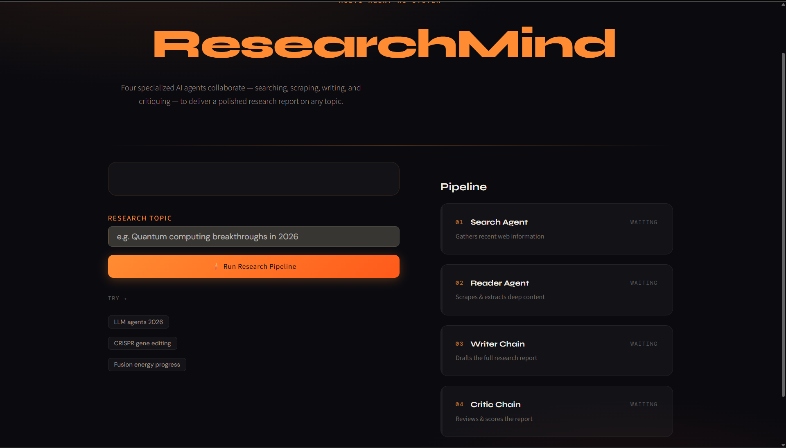

# 🧠 ResearchMind – Multi-Agent AI Research Assistant

ResearchMind is an AI-powered research assistant that automates web research and generates structured reports on user-provided topics using a multi-agent architecture.

Instead of relying on a single LLM response, ResearchMind divides the research workflow into specialized agents and chains for searching, reading, writing, and evaluating information.

## 🚀 Features

- **AI-Powered Web Search:** Uses Tavily API to retrieve relevant and up-to-date web search results.
- **Multi-Agent Architecture:** Uses LangChain agents to search the web and extract useful information from webpages.
- **Web Scraping:** Extracts relevant webpage content using Requests and BeautifulSoup.
- **Automated Report Generation:** Uses an LLM and LCEL chain to generate structured research reports.
- **AI-Based Evaluation:** A critic chain evaluates the generated report and provides a score, strengths, and areas for improvement.
- **Interactive UI:** Built with Streamlit for an easy-to-use research experience.
- **Download Reports:** Allows users to download generated research reports.

## 🏗️ System Architecture

ResearchMind consists of two AI agents and two LLM chains connected through a sequential research pipeline.

| Component | Responsibility |
|---|---|
| Search Agent | Searches the web using Tavily |
| Reader Agent | Extracts useful content from webpages |
| Writer Chain | Generates a structured research report |
| Critic Chain | Evaluates the report and provides feedback |

## 🔄 Workflow

```text
             User Research Topic
                      |
                      v
                Search Agent
                      |
                      v
              Tavily Web Search
                      |
                      v
                Reader Agent
                      |
                      v
             Webpage Scraping
                      |
                      v
                 Writer Chain
                      |
                      v
              Research Report
                      |
                      v
                 Critic Chain
                      |
                      v
             Evaluation Feedback
                      |
                      v
               Final Output
```

## 📸 Application Screenshot

### ResearchMind Dashboard



## 🛠️ Tech Stack

- **Language:** Python
- **LLM Framework:** LangChain
- **LLM:** OpenAI GPT-4o-mini
- **Web Search:** Tavily API
- **Web Scraping:** Requests, BeautifulSoup
- **Frontend:** Streamlit
- **Environment Management:** python-dotenv

## 📁 Project Structure

```text
ResearchMind/
│
├── agents.py          # Search and Reader agents
├── tools.py           # Web search and scraping tools
├── pipeline.py        # Sequential research pipeline
├── app.py             # Streamlit application
├── requirements.txt   # Project dependencies
├── .gitignore         # Ignored files and folders
├── README.md          # Project documentation
│
└── screenshots/
    └── researchmind-ui.png
```

## ⚙️ Installation & Setup

### 1. Clone the repository

```bash
git clone https://github.com/Anurag123731/ResearchMind.git
cd ResearchMind
```

### 2. Create a virtual environment

```bash
python -m venv .venv
```

### 3. Activate the virtual environment

**Windows:**

```bash
.venv\Scripts\activate
```

### 4. Install dependencies

```bash
pip install -r requirements.txt
```

### 5. Configure environment variables

Create a `.env` file in the project root directory and add your API keys:

```env
OPENAI_API_KEY=your_openai_api_key
TAVILY_API_KEY=your_tavily_api_key
```

### 6. Run the application

```bash
streamlit run app.py
```

## 📄 Research Report Output

ResearchMind generates structured Markdown research reports containing:

- Introduction
- Key Findings
- Conclusion
- Sources

The Critic Chain additionally provides:

- Evaluation Score
- Strengths
- Areas to Improve
- Final Verdict

## 🔮 Future Improvements

- Implement iterative research and report refinement using LangGraph.
- Add parallel webpage scraping for faster research.
- Improve report evaluation and source verification.
- Support exporting reports in PDF format.

## 👨‍💻 Author

**Anurag Rawat**

- GitHub: [Anurag123731](https://github.com/Anurag123731)
- Repository: [ResearchMind](https://github.com/Anurag123731/ResearchMind)
